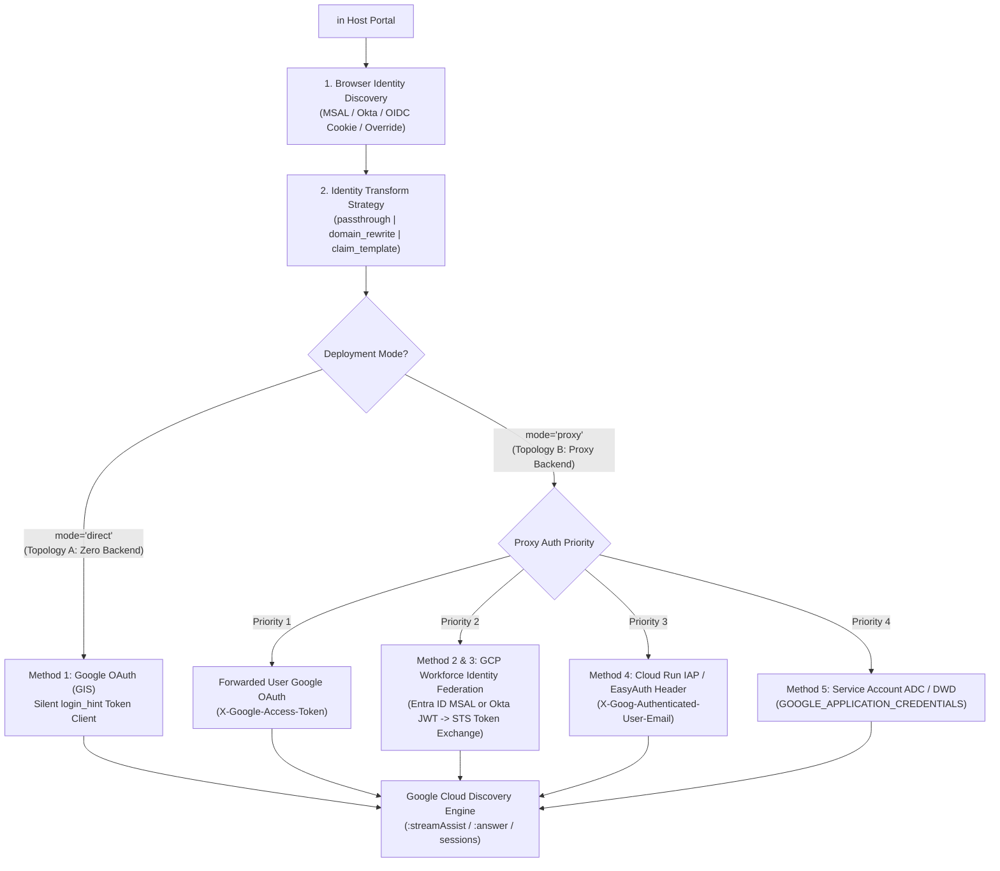

# Gemini Enterprise Omnibar (`<gemini-omnibar>`) — Architecture & Implementation Plan

This document defines the architecture, folder structure, **Search Bar Variants (`large`, `small`, `icon`)**, and **Authentication / Identity Methods** for the customer-agnostic `<gemini-omnibar>` reusable asset.

---

## 1. Complete Folder Structure

```text
omnibar/
├── docs/
│   └── ARCHITECTURE_AND_PLAN.md            # Full architecture, variants & identity matrix
├── packages/
│   └── omnibar-wc/
│       ├── dist/
│       │   └── gemini-omnibar.js           # Bundled UMD + ESM Web Component
│       └── src/
│           ├── gemini-omnibar.ts           # Core Shadow DOM <gemini-omnibar> Custom Element
│           ├── direct-client.ts            # Topology A: Serverless browser-direct REST client
│           ├── auth-adapters.ts            # Browser SSO discovery + identity transform engine
│           ├── markdown.ts                 # Regex Pattern Matching Markdown + [1] citation renderer
│           ├── index.ts                    # Public package exports
│           ├── variants/                   # Search Bar Form-Factor Modules
│           │   ├── large/
│           │   │   └── index.ts            # Hero multiline omnibar + inline expand-down drawer
│           │   ├── small/
│           │   │   └── index.ts            # Compact 40px navbar search bar + floating popover drawer
│           │   └── icon/
│           │       └── index.ts            # 40×40 icon button -> 290px animated bar + floating popover
│           └── auth/                       # Pluggable Identity & Authentication Modules
│               ├── google-oauth-gis/
│               │   └── index.ts            # Browser-direct Google Identity Services (login_hint)
│               ├── entra-msal-wif/
│               │   └── index.ts            # Microsoft Entra ID (MSAL cache + WIF STS exchange)
│               ├── okta-oidc-wif/
│               │   └── index.ts            # Okta OIDC token storage + WIF STS exchange
│               ├── cloudrun-iap/
│               │   └── index.ts            # Cloud Run IAP / EasyAuth header extraction
│               ├── service-account-dwd/
│               │   └── index.ts            # GCP Service Account ADC / Domain-Wide Delegation
│               └── identity-transforms/
│                   └── index.ts            # passthrough, domain_rewrite, claim_template strategies
├── examples/
│   ├── static-intranet-demo.html           # Interactive playground showcasing large, small, and icon
│   ├── variants/                           # Drop-in Guides for Each Search Bar Variant
│   │   ├── large/README.md                 # Large Hero Omnibar implementation guide
│   │   ├── small/README.md                 # Small Compact Navbar Search Bar guide
│   │   └── icon/README.md                  # Expandable 40×40 Icon Search Bar guide
│   ├── auth/                               # End-to-End Implementation Guides per Identity Type
│   │   ├── google-oauth-gis/README.md      # Method 1: Google OAuth (GIS) with login_hint
│   │   ├── entra-msal-wif/README.md        # Method 2: Microsoft Entra ID (MSAL) + GCP WIF STS
│   │   ├── okta-oidc-wif/README.md         # Method 3: Okta / Generic OIDC + GCP WIF STS
│   │   ├── cloudrun-iap/README.md          # Method 4: Cloud Run IAP / Azure EasyAuth Headers
│   │   ├── service-account-dwd/README.md   # Method 5: Service Account ADC / Workspace DWD
│   │   └── identity-transforms/README.md   # Corporate UPN -> Cloud Identity Email Transforms
│   ├── react-example/
│   │   └── GeminiOmnibar.tsx               # React / Next.js typed wrapper (supports variant prop)
│   └── sharepoint-spfx/
│       └── GeminiOmnibarWebPart.ts         # SharePoint Online SPFx Web Part
├── backends/
│   ├── node-proxy/                         # Zero-dependency Node.js / Express proxy + WIF STS
│   ├── python-fastapi/                     # Python FastAPI APIRouter drop-in
│   └── dotnet-controller/                  # ASP.NET Core C# Web API Controller
├── deploy/
│   ├── cloudrun-iap.sh                     # 1-command Cloud Run + IAP deployment script
│   └── terraform/                          # Terraform module for Cloud Run + WIF + Discovery Engine
└── test/
    └── gemini-omnibar.test.ts              # Behavioral + negative/adversarial Jest test suite
```

---

## 2. Search Bar Variants (`large`, `small`, `icon`)

The `<gemini-omnibar>` Web Component supports three distinct UI form factors controlled via the `variant` attribute (`variant="large" | "small" | "icon"`). All three variants share the same multi-turn session state, `:streamAssist` / `:answer` engine, grounded `[1]` citations, and `/r/session/{sessionId}` deep-link handoff.

| Variant | Attribute | Form Factor & Dimensions | Conversation Drawer Layout | Source & Example Folder |
| :--- | :--- | :--- | :--- | :--- |
| **1. Large (Hero Omnibar)** | `variant="large"` *(default)* | Full-width (`max-width: 980px`), multiline pill (`border-radius: 28px`, `padding: 16px 18px`) with mode selector (`Ask` / `Answer`). | **Inline Expand-Down Drawer**: Expands directly beneath the prompt bar inside the normal document flow. | [`packages/omnibar-wc/src/variants/large`](../packages/omnibar-wc/src/variants/large/index.ts)<br>[`examples/variants/large`](../examples/variants/large/README.md) |
| **2. Small (Compact Navbar Bar)** | `variant="small"` | Single-line `40px`-tall compact search input (`width: 340px`, `border-radius: 11px`) designed for top navigation bars and sticky headers. | **Floating Tethered Popover**: `position: absolute; top: calc(100% + 10px); right: 0; width: min(680px, 92vw); z-index: 1000` so the navbar never stretches vertically. | [`packages/omnibar-wc/src/variants/small`](../packages/omnibar-wc/src/variants/small/index.ts)<br>[`examples/variants/small`](../examples/variants/small/README.md) |
| **3. Icon (Expandable Trigger)** | `variant="icon"` | Starts as a `40px × 40px` icon button (`border-radius: 12px`). Smoothly animates to `290px` width (`cubic-bezier(0.22, 1, 0.36, 1)`) on hover, focus, or click; collapses on `Escape`. | **Floating Tethered Popover**: `position: absolute; top: calc(100% + 10px); right: 0; width: min(640px, 92vw); z-index: 1000`. | [`packages/omnibar-wc/src/variants/icon`](../packages/omnibar-wc/src/variants/icon/index.ts)<br>[`examples/variants/icon`](../examples/variants/icon/README.md) |

---

## 3. Authentication & Identity Architecture Matrix

Enterprise customers connect to Gemini Enterprise (Google Cloud Discovery Engine) under different identity and network topologies. Below are the **5 Authentication Methods** and **3 Identity Transform Strategies**, where each is implemented in the codebase, and how to configure them.



### 3.1 Authentication Methods (1–5)

| # | Authentication Method | Topology | Document ACL Enforcement | Source Module | Step-by-Step Implementation Guide |
| :--- | :--- | :--- | :--- | :--- | :--- |
| **1** | **Google OAuth 2.0 via Google Identity Services (`login_hint`)** | **Topology A (`mode="direct"`)** or **Topology B (`mode="proxy"`)** | **Per-User ACLs** (End-user's own Google Cloud / Workspace token) | [`src/auth/google-oauth-gis`](../packages/omnibar-wc/src/auth/google-oauth-gis/index.ts) | [`examples/auth/google-oauth-gis/README.md`](../examples/auth/google-oauth-gis/README.md) |
| **2** | **Microsoft Entra ID (MSAL) + GCP Workforce Identity Federation (WIF)** | **Topology B (`mode="proxy"`)** | **Per-User ACLs** (Entra JWT exchanged at `sts.googleapis.com/v1/token` for a per-user federated GCP token) | [`src/auth/entra-msal-wif`](../packages/omnibar-wc/src/auth/entra-msal-wif/index.ts) + [`backends/node-proxy/index.js`](../backends/node-proxy/index.js) | [`examples/auth/entra-msal-wif/README.md`](../examples/auth/entra-msal-wif/README.md) |
| **3** | **Okta / Generic OIDC + GCP Workforce Identity Federation (WIF)** | **Topology B (`mode="proxy"`)** | **Per-User ACLs** (Okta `idToken`/`accessToken` or OIDC cookie exchanged via GCP STS WIF) | [`src/auth/okta-oidc-wif`](../packages/omnibar-wc/src/auth/okta-oidc-wif/index.ts) + [`backends/node-proxy/index.js`](../backends/node-proxy/index.js) | [`examples/auth/okta-oidc-wif/README.md`](../examples/auth/okta-oidc-wif/README.md) |
| **4** | **Cloud Run Identity-Aware Proxy (IAP) / Azure App Service EasyAuth** | **Topology B (`mode="proxy"`)** | **Zero-Client-Code SSO** (Cloud Run LB verifies user and injects `X-Goog-Authenticated-User-Email`) | [`src/auth/cloudrun-iap`](../packages/omnibar-wc/src/auth/cloudrun-iap/index.ts) + [`deploy/cloudrun-iap.sh`](../deploy/cloudrun-iap.sh) | [`examples/auth/cloudrun-iap/README.md`](../examples/auth/cloudrun-iap/README.md) |
| **5** | **GCP Service Account (ADC) / Google Workspace Domain-Wide Delegation** | **Topology B (`mode="proxy"`)** | **Shared Engine or Impersonated User** (Server-side Service Account with `X-User-Email` session ownership) | [`src/auth/service-account-dwd`](../packages/omnibar-wc/src/auth/service-account-dwd/index.ts) + [`backends/node-proxy/index.js`](../backends/node-proxy/index.js) | [`examples/auth/service-account-dwd/README.md`](../examples/auth/service-account-dwd/README.md) |

### 3.2 Identity Transform Strategies (`passthrough`, `domain_rewrite`, `claim_template`)

Many enterprises have a mismatch between the corporate IdP username (for example, an opaque employee ID `dz9812@nam.corp.company.com` in Active Directory) and the user's Google Cloud Identity email (`first.last@company.com`). Both the browser Web Component and the proxy backend implement three configurable strategies in [`src/auth/identity-transforms`](../packages/omnibar-wc/src/auth/identity-transforms/index.ts):

1. **`passthrough` (Default)**:
   - Normalizes and lowercases the discovered email (`Jane.Doe@Acme.com` → `jane.doe@acme.com`).
   - Used when Entra ID / Okta / Google Workspace emails already match Google Cloud Identity.
2. **`domain_rewrite`**:
   - Triggered when the UPN ends with `identity-source-domain` (e.g., `corp.company.com`).
   - Uses `given_name` and `family_name` (or parses `"Last, First"` from `displayName`) to construct `first.last@{identity-domain}`. If no name claims exist, rewrites the domain suffix (`user@nam.corp.company.com` → `user@company.com`).
3. **`claim_template`**:
   - Formats any custom email structure using `{given_name}`, `{family_name}`, `{upn_local}`, and `{domain}` placeholders (e.g., `{given_name}_{family_name}@{domain}`).
